# Evidencias del Taller por Fase

**Taller Semana 10 — Pipeline CI/CD en Jenkins (Test, Sonar, Nexus y Despliegue)**
Ingeniería de Software V · Universidad Icesi · 2026-2

## Entorno utilizado

| Componente | Dónde corre | Acceso |
|---|---|---|
| SonarQube 10 Community | Contenedor en el PC local (`docker compose up -d sonarqube`) | `http://localhost:9000` |
| Jenkins LTS (JDK 17 + Maven + Docker CLI) | Contenedor en el PC local | `http://localhost:9182` |
| Sonatype Nexus 3 (`maven-releases`) | EC2 en AWS | `http://<IP_EC2>:9181` |
| `product-api` desplegado | Contenedor en el PC local | `http://localhost:8085/api/products` |

Desde Jenkins, SonarQube y la aplicación desplegada se alcanzan por `host.docker.internal`, porque Jenkins corre en un contenedor.

---

## Fase 1 — Preparación del entorno y SonarQube

**e) Quality Gate estricto `Icesi-DevOps-Gate`**

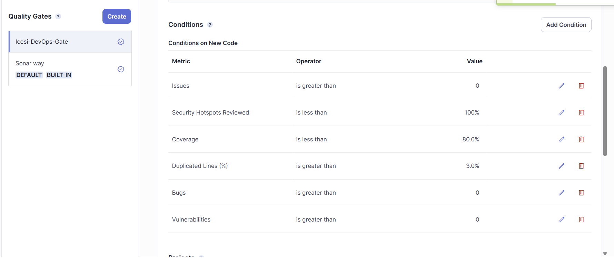

**f) Webhook de SonarQube hacia Jenkins**

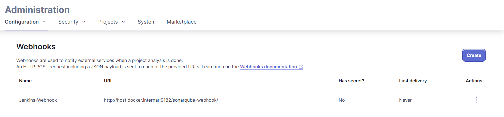

**g) Configuración en Jenkins: plugin, credencial y servidor SonarQube**

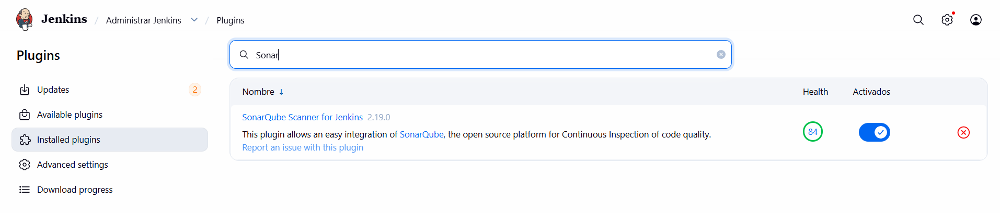

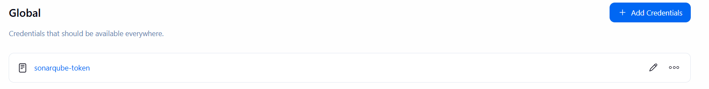

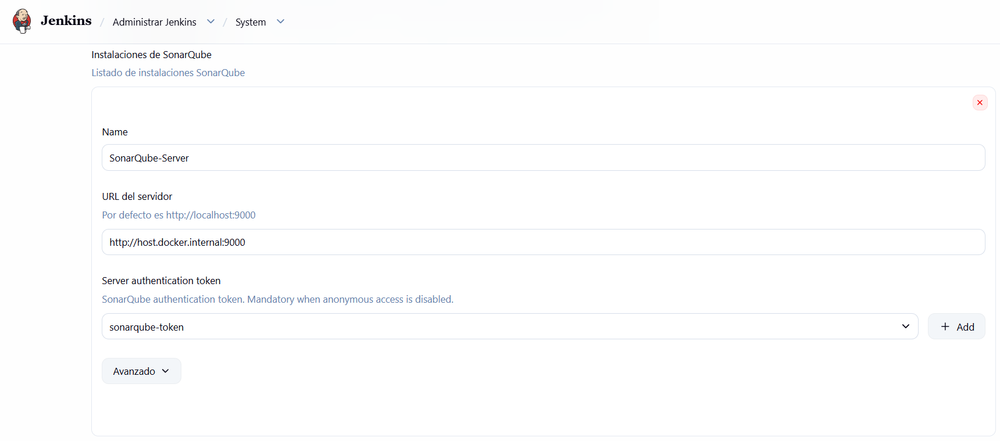

---

## Fase 2 — Etapa 1: Test y cobertura con JaCoCo

Primeras ejecuciones del pipeline: la etapa de pruebas pasa y el Quality Gate falla por los defectos inyectados.

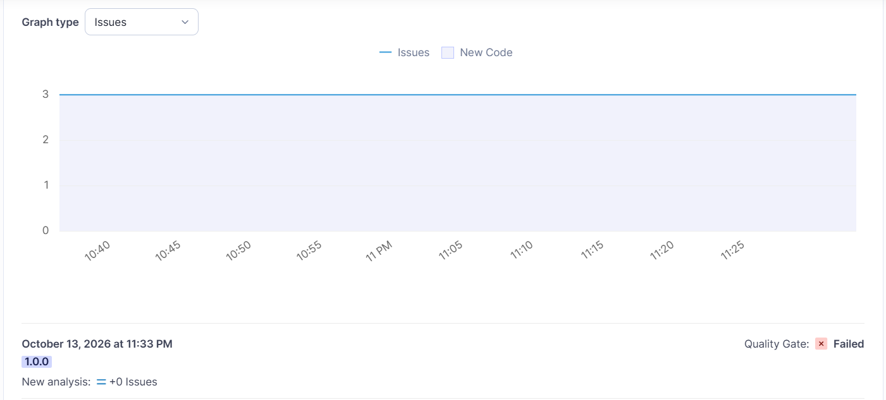

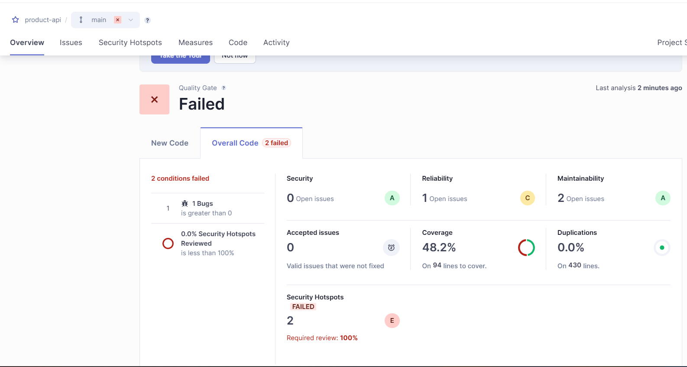

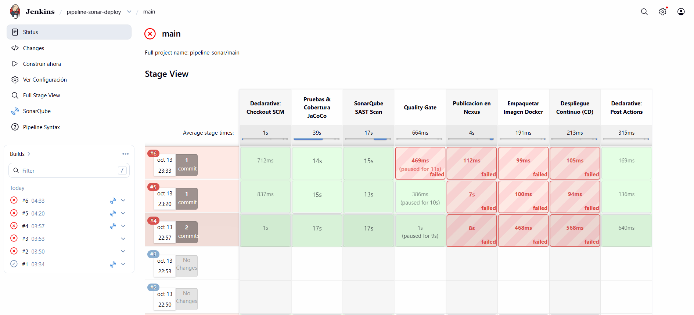

---

## Fase 3 — Etapa 2: Validación SAST y Quality Gate

Corrección de los defectos (CWE-330: `Random` → `SecureRandom`; CWE-476: `Optional.get()` → `orElseThrow()`) y revisión del Security Hotspot. El Quality Gate pasa a **Passed**.

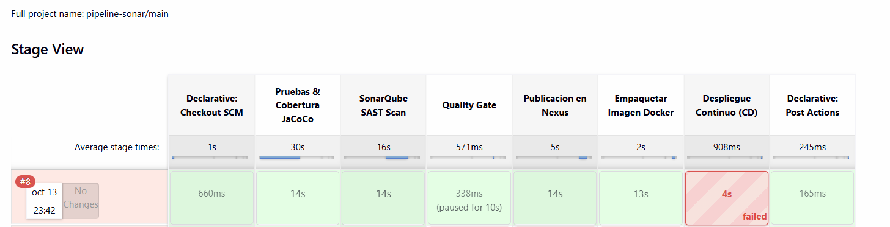

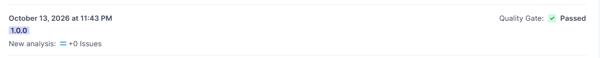

---

## Fase 4 — Etapa 3: Publicación en Nexus e imagen Docker

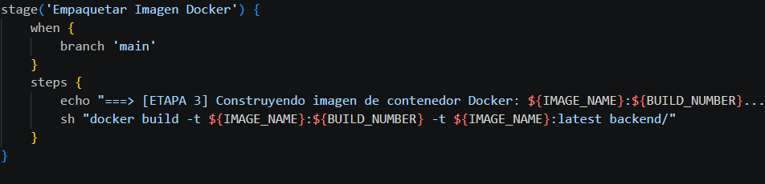

---

## Fase 5 — Etapa 4: Despliegue continuo y healthcheck

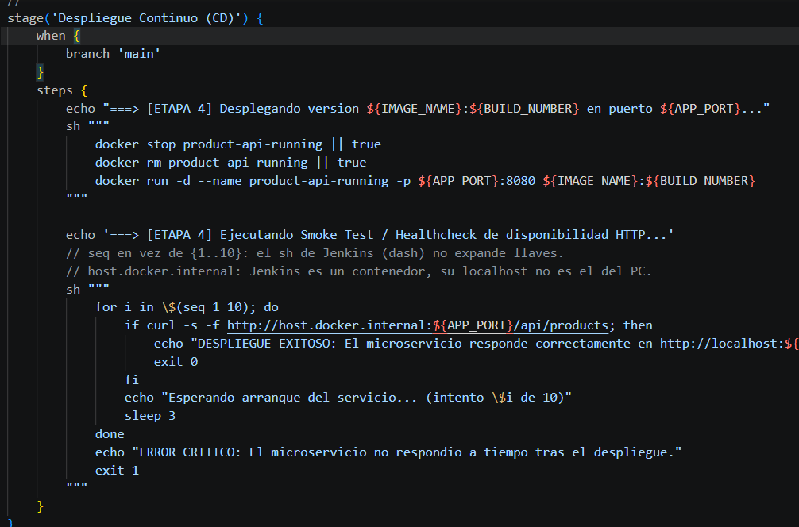

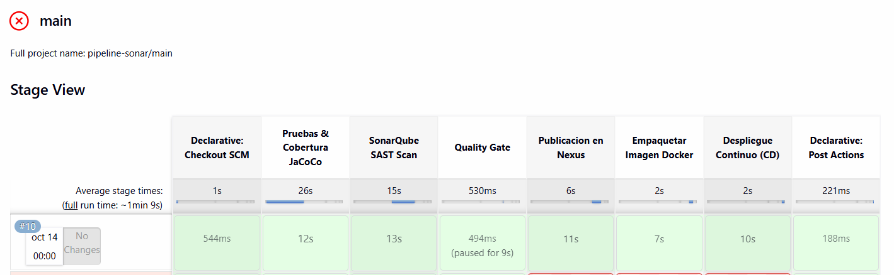

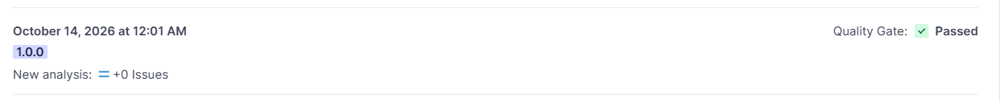

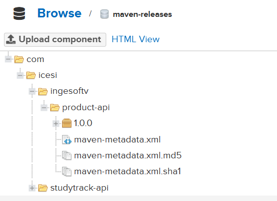

---

## Checklist de autoverificación (sección 4 de la guía)

| Hito | Componente | Evidencia |
|---|---|---|
| 1 | Servidor SonarQube | Fase 1 (e) |
| 2 | Webhook integrado | Fase 1 (f) |
| 3 | Etapa 1: Test JaCoCo | Fase 2 |
| 4 | Etapa 2: Sonar Scan | Fase 2 y Fase 3 |
| 5 | Etapa 2.1: Quality Gate (rojo y luego verde) | Fase 2 (fallo) y Fase 3 (aprobado) |
| 6 | Etapa 3: Publicación | Fase 4 |
| 7 | Etapa 4: Despliegue | Fase 5 |

Las respuestas al cuestionario están en [respuestas_cuestionario.md](respuestas_cuestionario.md).
